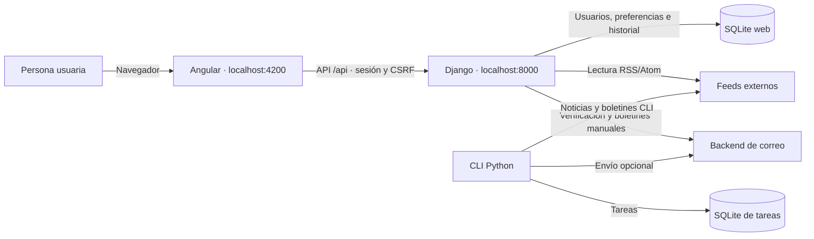

# Gestor de tareas

Aplicación de terminal para guardar tareas pendientes en SQLite y consultar
noticias de feeds RSS 2.0 o Atom. El código usa la biblioteca estándar de
Python; el boletín requiere `tzdata` en Windows cuando el sistema no incluye
datos de zona horaria.

El proyecto incluye además una aplicación web Django local en desarrollo para
registro, inicio de sesión, preferencias individuales y envío manual de
boletines. No es un despliegue de producción ni programa envíos o alertas.

## Funcionalidades

### Aplicación web

- Registro e inicio de sesión con sesiones de Django.
- Verificación de correo mediante enlace firmado y con caducidad; en la configuración local predeterminada, el mensaje aparece en la consola del backend.
- Consulta de noticias RSS/Atom con filtros por tema y fuentes definidas en `data/feeds.json`.
- Preferencias por cuenta: temas, habilitación y horario del boletín, zona horaria y opciones de alertas.
- Vista previa y solicitud **manual** de un boletín por correo. Se exige correo verificado y hay un intervalo mínimo de cinco minutos entre intentos.
- Historial por cuenta con hasta diez intentos recientes y sus estados.
- Panel de administración de Django en `/admin/`.

Las preferencias de alertas se pueden guardar, pero no se generan alertas. La hora y la opción de habilitar el boletín tampoco activan una tarea programada.

El lector comparte el procesamiento RSS/Atom con la CLI. Las fuentes configuradas actualmente son feeds públicos de BBC para tecnología, economía y actualidad; IA y ciencia aún no tienen fuentes asociadas. Cada consulta tiene un límite de espera de 10 segundos y de 1 MiB por feed; un feed que falla genera un aviso sin impedir consultar los demás.

### CLI independiente

El módulo `app` permite añadir, listar y completar tareas en `data/tasks.db`, además de consultar feeds, generar una vista previa de boletín y configurar o enviar correo desde la terminal. Esta base de tareas es independiente de `backend/db.sqlite3` y no se comparte con las cuentas web.

Ejemplos:

```powershell
python -m app add "Preparar presentación"
python -m app list
python -m app complete 1
python -m app news --limit 10
python -m app briefing
python -m app email
```

Los comandos de correo muestran una vista previa por defecto. El envío solo se realiza al indicar `--send`; consulta [Configuración del correo](#configuración-del-correo) antes de usarlo.

## Tecnologías

| Tecnología | Función |
|---|---|
| Angular | Interfaz web de noticias, cuenta, preferencias, boletín e historial. |
| Django | API, autenticación, verificación de correo, lógica de boletines y administración. |
| Python | Backend, lector RSS/Atom y módulo CLI. |
| TypeScript | Lógica de la aplicación Angular. |
| SQLite | Persistencia local: `backend/db.sqlite3` para la web y `data/tasks.db` para la CLI. |

## Arquitectura



El servidor de desarrollo de Angular reenvía `/api/` a Django mediante `frontend/proxy.conf.json`. La CLI y la aplicación web comparten componentes de lectura de noticias, pero mantienen separados sus datos de tareas y de cuentas.

La API web incluye sesión y CSRF (`GET /api/session/`, `GET /api/csrf/`), autenticación (`POST /api/login/`, `POST /api/logout/`), registro y verificación (`POST /api/register/`, `GET /api/verify-email/`, `POST /api/verify-email/confirm/`), preferencias (`GET /api/preferences/`, `POST /api/preferences/save/`, `POST /api/preferences/resend-verification/`), noticias (`GET /api/news/`) y boletines (`GET /api/newsletter/`, `POST /api/newsletter/send/`, `GET /api/newsletter/history/`). Las operaciones de usuario requieren sesión; las solicitudes de escritura usan protección CSRF.

## Instalación y ejecución

Los siguientes pasos son para **Windows y PowerShell**. Se basan en Python 3.14 y en los scripts npm definidos por el proyecto. Necesitas también Node.js y npm instalados.

### 1. Clonar el repositorio

```powershell
git clone https://github.com/JiajunQiuWu/asistente-whatsapp.git
Set-Location asistente-whatsapp
```

### 2. Preparar el entorno virtual de Python

```powershell
$env:GMAIL_ADDRESS = "tu-cuenta@gmail.com"
$env:EMAIL_TO = "destinatario@ejemplo.com"
python -m app email-config
```

La contraseña se solicita de forma oculta y se guarda con `keyring`, usando el
servicio `asistente-whatsapp.gmail` y la dirección remitente como usuario. No se
escribe en un archivo. En el envío, el programa busca primero
`GMAIL_APP_PASSWORD`, después el Administrador de credenciales de Windows y,
si el almacén está disponible pero no hay una contraseña guardada, la solicita
de forma oculta. Si el almacén seguro no está disponible, informa del error y
no recurre a un almacenamiento en texto plano.

Para entornos automatizados, `--non-interactive` evita solicitar la contraseña.
Configura `GMAIL_APP_PASSWORD` en el entorno o guarda previamente la credencial
con `email-config`:

```powershell
python -m app email --send
python -m app email --send --non-interactive
python -m app email --demo --send
python -m app email --demo --send --non-interactive
```

El primer comando prepara el boletín con noticias de los feeds y tareas
pendientes reales. El segundo prepara solo contenido ficticio, pero **sí envía
un correo** al destinatario configurado. No ejecutamos estos comandos al probar
el proyecto. La conexión usa SMTP de Gmail con STARTTLS. Si Gmail acepta el
mensaje, la aplicación lo informa, pero esto no garantiza su llegada a la
bandeja de entrada. No hay reintentos.

La vista previa `python -m app email` no consulta credenciales. El comando
`email-config` configura una contraseña de aplicación, pero no envía correos.
No se implementa todavía el envío diario.

En Windows, Python puede no tener instalados los datos de zonas horarias que
necesita `ZoneInfo`. Instala la dependencia desde la carpeta del proyecto:

```powershell
python -m pip install -r requirements.txt
```

### 4. Aplicar las migraciones de Django

Desde la raíz del repositorio:

```powershell
python backend\manage.py migrate
```

La migración de verificación aplica unicidad de correo sin distinguir mayúsculas/minúsculas. Si una base existente contiene direcciones duplicadas, resuelve los conflictos manualmente antes de volver a ejecutar la migración.

Opcionalmente, crea una cuenta de administración para `/admin/`:

```powershell
python backend\manage.py createsuperuser
```

### 5. Iniciar el backend

En una terminal de PowerShell, desde la raíz:

```powershell
python backend\manage.py runserver localhost:8000
```

El backend usa el correo de consola de manera predeterminada; no abre una conexión SMTP.

### 6. Instalar e iniciar Angular

Abre una segunda terminal en la raíz del repositorio:

```powershell
Set-Location frontend
npm ci
npm start
```

El servidor de Angular escucha en `localhost:4200` y utiliza el proxy `/api/` configurado en el proyecto.

### 7. Abrir la aplicación

Visita [http://localhost:4200/](http://localhost:4200/). La aplicación te llevará al inicio de sesión. Para probar el registro con el backend de correo predeterminado, revisa la consola de Django y abre el enlace de verificación que aparece allí.

Utiliza `localhost` en ambos servidores y en el navegador para mantener el mismo origen de las cookies de sesión y CSRF.

## Configuración del correo

En desarrollo, Django usa `django.core.mail.backends.console.EmailBackend`: los correos de verificación y los intentos de boletín se muestran como simulaciones en la terminal, no se envían a Gmail.

Para habilitar Gmail SMTP:

1. Activa la verificación en dos pasos de la cuenta remitente y crea una **contraseña de aplicación** de Google.
2. Desde la raíz del proyecto, guarda la contraseña en el Administrador de credenciales de Windows. El comando la solicita sin mostrarla:

   ```powershell
   $env:GMAIL_ADDRESS = "tu-cuenta@gmail.com"
   python -m app email-config
   ```

3. En la misma sesión de PowerShell, selecciona SMTP y arranca Django:

   ```powershell
   $env:DJANGO_EMAIL_BACKEND = "django.core.mail.backends.smtp.EmailBackend"
   $env:EMAIL_HOST = "smtp.gmail.com"
   $env:EMAIL_PORT = "587"
   $env:EMAIL_USE_TLS = "true"
   $env:EMAIL_TIMEOUT = "10"
   $env:EMAIL_HOST_USER = $env:GMAIL_ADDRESS
   $env:DEFAULT_FROM_EMAIL = $env:GMAIL_ADDRESS
   python backend\manage.py runserver localhost:8000
   ```

El backend de Django reutiliza la contraseña guardada para la cuenta Gmail; también admite `GMAIL_APP_PASSWORD` o `EMAIL_HOST_PASSWORD` como variables de entorno. No guardes contraseñas en el repositorio ni en archivos compartidos.

| Variable | Uso |
|---|---|
| `DJANGO_EMAIL_BACKEND` | Selecciona el backend de correo de Django; SMTP requiere configurarlo explícitamente. |
| `EMAIL_HOST`, `EMAIL_PORT`, `EMAIL_USE_TLS`, `EMAIL_TIMEOUT` | Parámetros de conexión SMTP. |
| `GMAIL_ADDRESS` / `EMAIL_HOST_USER` | Cuenta Gmail remitente. |
| `GMAIL_APP_PASSWORD` / `EMAIL_HOST_PASSWORD` | Contraseña de aplicación; alternativa al almacén de credenciales de Windows. |
| `EMAIL_TO` | Dirección destinataria usada únicamente por la CLI. |
| `DEFAULT_FROM_EMAIL` | Dirección que Django muestra como remitente. |
| `EMAIL_VERIFICATION_BASE_URL` | Origen que Django usa para construir enlaces de verificación. En local: `http://localhost:8000`. |
| `ANGULAR_FRONTEND_BASE_URL` | Origen de la SPA incluido en enlaces creados desde Angular. En local: `http://localhost:4200`. |
| `DJANGO_SECRET_KEY` | Clave de Django; el valor de respaldo incluido en la configuración es solo de desarrollo. |

La CLI tiene un flujo de envío separado. Para enviar desde ella, configura el remitente y el destinatario en la sesión de PowerShell, guarda la contraseña con `python -m app email-config` o usa `GMAIL_APP_PASSWORD`, y ejecuta `python -m app email --send`:

```powershell
$env:GMAIL_ADDRESS = "tu-cuenta@gmail.com"
$env:EMAIL_TO = "destinatario@ejemplo.com"
python -m app email --send
```

No se envía correo sin `--send`.

## Seguridad

El proyecto incorpora validación de contraseñas de Django, sesiones, protección CSRF para las solicitudes de escritura, verificación de correo con tokens firmados y caducidad de 24 horas, unicidad de correo sin distinguir mayúsculas/minúsculas y acceso a preferencias e historial asociado a la sesión. El envío manual exige correo verificado y limita los intentos; la CLI almacena las contraseñas de aplicación en el Administrador de credenciales de Windows cuando se usa `email-config`.

**La configuración no está preparada automáticamente para producción.** `DEBUG` permanece habilitado, `ALLOWED_HOSTS` solo permite nombres locales y el `SECRET_KEY` de respaldo es inseguro. No expongas el servidor de desarrollo a Internet ni reutilices sus valores por defecto en un despliegue. Antes de publicar el servicio se requiere configurar y revisar explícitamente el entorno, los secretos, los hosts permitidos, HTTPS y un servidor de aplicaciones adecuado.

## Pruebas

Ejecuta estos comandos desde la raíz. Las pruebas Django usan feeds y correo simulados; no envían correos reales.

```powershell
python -m unittest discover -s tests -v
python backend\manage.py check
python backend\manage.py test accounts
Set-Location frontend
npm test -- --watch=false
```

Para compilar Angular:

```powershell
npm run build
```

Ejecuta los dos últimos comandos desde `frontend`.

## Roadmap

### Completado

- [x] Aplicación web Angular y API Django para registro, inicio de sesión y preferencias.
- [x] Consulta de noticias RSS/Atom desde fuentes configuradas.
- [x] Verificación de correo y boletín manual con historial de intentos.
- [x] CLI independiente para gestionar tareas locales.

### Pendiente

- [ ] Integración con WhatsApp.
- [ ] Envíos automáticos programados; el horario actual solo se almacena como preferencia.
- [ ] Alertas personalizadas; por ahora solo se pueden guardar sus preferencias.
- [ ] Despliegue público con configuración y medidas de seguridad adecuadas para producción.
- [ ] Incorporar capturas reales de noticias, acceso, registro, preferencias, boletín e historial.

## Estado del proyecto

El proyecto sigue en desarrollo y actualmente está orientado a pruebas locales. Las fuentes disponibles se limitan a las configuradas en `data/feeds.json`: ahora hay feeds para tecnología, economía y actualidad; IA y ciencia todavía no tienen fuentes asociadas. Los boletines web se solicitan manualmente, el correo predeterminado es una simulación de consola y las preferencias de alertas no generan notificaciones. La web todavía no ofrece recuperación de contraseña ni cambio de correo. La CLI mantiene sus tareas en una base local separada y no se integra con las cuentas web.
